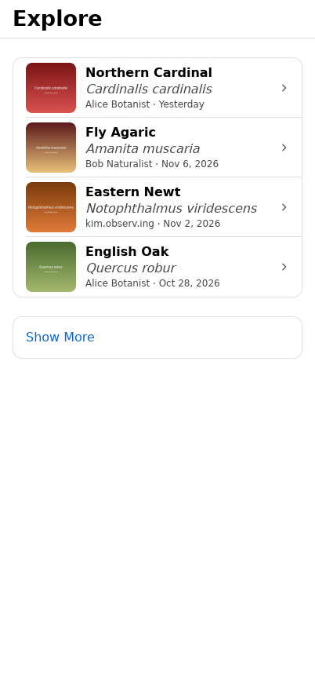
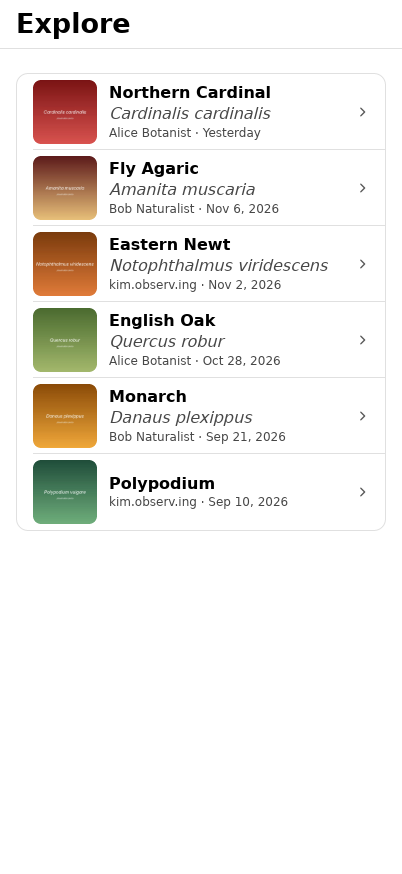
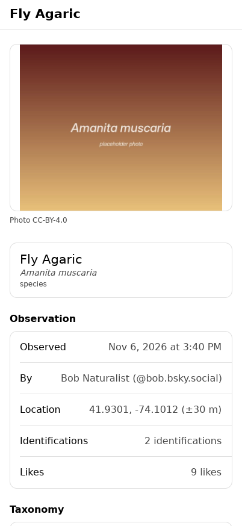

# Exact spike: explore feed and observation detail

A throwaway spike, not a migration: observ.ing's explore feed and an
observation's detail page rebuilt in [Exact](https://github.com/expo/exact),
Expo's cross-platform runtime (Contract views, TypeScript data, native
UIKit/AppKit/Linux hosts, a small DOM runtime on the web).

- `app.contract`: the view. The feed (photo, names, observer, day, Show More
  paging) pushes `/observation/:did/:rkey`, the detail.
- `app.ts`: the data module. It reads `GET /api/feeds/explore?limit=N` in the
  appview's current `Occurrence` JSON shape and flattens each row for the view.
- `server.ts` + `fixtures.ts`: a stand-in appview serving sample rows in that
  shape, with generated placeholder photos in `assets/photos` (PNG: Exact's
  desktop Linux host has no JPEG decoder).
- `app.test.contract`: two tests, passing on the Linux host.

  

Screenshots are from Exact's native Linux host, driven headless by its agent.

## Running it

It needs an Exact checkout, found at `../../expo/exact` relative to this
directory, or wherever `EXACT2` points:

```sh
git clone https://github.com/expo/exact ~/src/exact
export EXACT2=~/src/exact
bun exact.mjs web          # the web dev loop (needs Chrome for test/agent web)
bun server.ts              # the stand-in appview, in another terminal
bun exact.mjs linux && bun exact.mjs test linux   # stop server.ts first: test starts its own
```

To read a real appview, change `API` in `app.ts`. Native hosts send no
cookies, so signed-in endpoints would need token auth.
