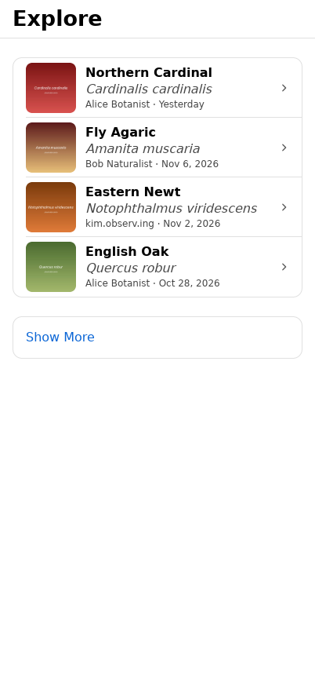
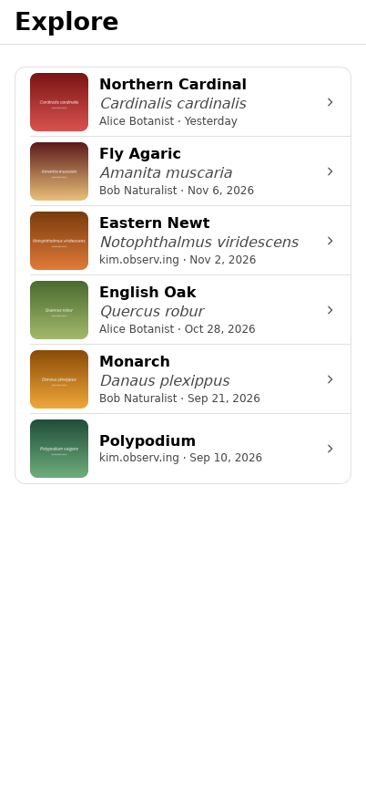
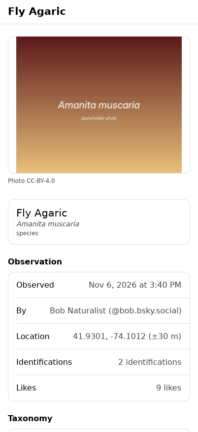

# Exact spike: explore feed and observation detail

A throwaway spike, not a migration: observ.ing's explore feed and an
observation's detail page rebuilt in [Exact](https://github.com/expo/exact),
Expo's cross-platform runtime (Contract views, TypeScript data, native
UIKit/AppKit/Linux hosts, a small DOM runtime on the web).

- `app.contract`: the view. The feed (photo, names, observer, day, Show More
  paging) pushes `/observation/:did/:rkey`, the detail.
- `app.ts`: the data module. It reads `GET /api/feeds/explore?limit=N` in the
  appview's current `Occurrence` JSON shape and flattens each row for the view.
- `server.ts`: the dev server `app.ts` reads. With `APPVIEW=<origin>` it proxies
  `/api/*` and `/media/*` to that appview (no appview has to allow Exact's dev
  origin); without it, it answers from `fixtures/`, swapping each photo for a
  placeholder PNG in `assets/photos` (Exact's Linux host has no JPEG decoder).
- `fixtures/`: real appview responses, recorded verbatim by `bun record.ts
  [origin]` (default https://observ.ing).
- `bindings/`: the appview's ts-rs types, copied from `frontend/src/bindings` by
  `bun sync-bindings.ts` (`--check` fails when stale): an Exact build reads only
  files inside this directory.
- `app.test.contract`: three tests against the recorded fixtures.

  

Screenshots are from Exact's native Linux host, driven headless by its agent.

## Running it

It needs an Exact checkout, found at `../../expo/exact` relative to this
directory, or wherever `EXACT2` points:

```sh
git clone https://github.com/expo/exact ~/src/exact
export EXACT2=~/src/exact
bun exact.mjs web                      # the web dev loop, at http://127.0.0.1:8765/
APPVIEW=https://observ.ing bun server.ts  # live data, in another terminal (omit APPVIEW for fixtures)
bun exact.mjs test                     # stop server.ts first: test starts its own on fixtures/
                                       # (CHROME=<path to Chrome> if Playwright's Chromium isn't installed)
```

To read a different appview, set `APPVIEW` (a local one is `http://localhost:3000`). Native hosts send no
cookies, so signed-in endpoints would need token auth.
